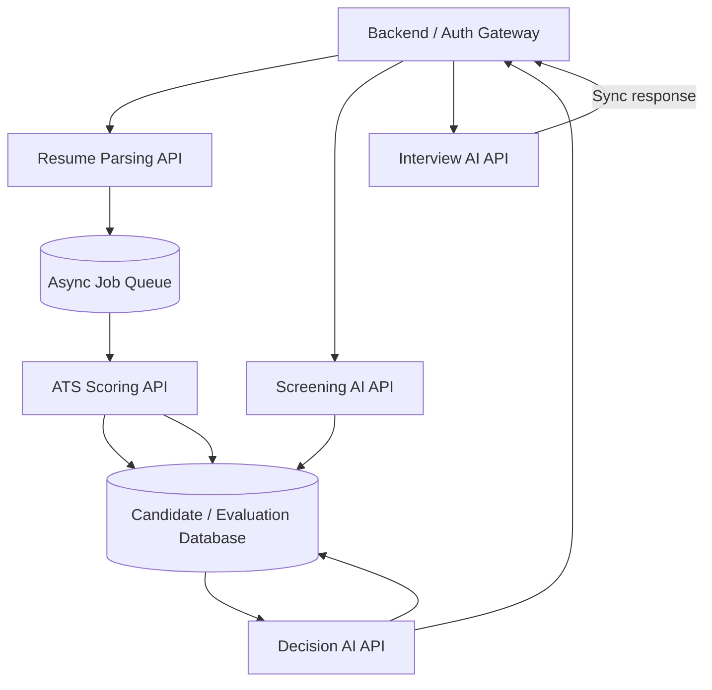

# Day 59 – API Mapping

**Modes:** resume processing is asynchronous; real-time interview scoring is synchronous.

**Contracts:** see `schemas/resume_parse_request.schema.json`, `schemas/ats_score_request.schema.json`, and `schemas/decision_response.schema.json`.

**Security:** authenticate every service call; authorize by role and purpose; use correlation IDs; avoid logging raw resumes/transcripts; encrypt data in transit and at rest.
