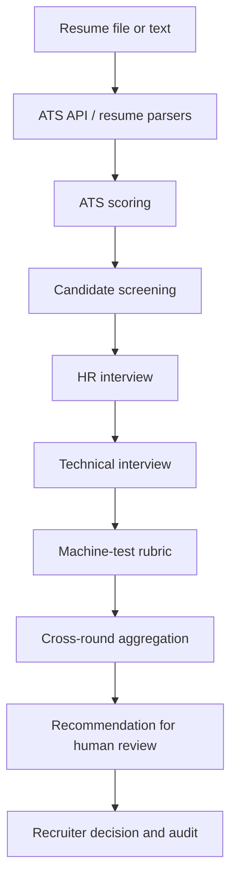

# Zecpath AI System — Technical Handbook

**Project:** Zecpath AI System  
**Organization:** Zecser Business LLP  
**Document status:** Consolidated developer reference (repository snapshot supplied for Days 61–65)

## 1. System overview
The repository is a modular Python recruitment-support prototype. It contains resume parsing, ATS scoring, screening, interview analysis, technical assessment, cross-round aggregation, recommendations, API endpoints, utilities and tests. It is not a fully deployed production hiring platform.

## 2. Architecture and workflow


Primary code areas:
- `ats_engine/`: FastAPI ATS service and scoring integration.
- `parsers/`: PDF/DOCX/text reading, resume normalization, section classification, skill/education/experience/certification parsing and job-description parsing.
- `screening_ai/`: screening conversation, answer intent, shortlisting and reports.
- `interview_ai/`: interview flow, follow-ups, technical interview, machine-test evaluation, final recommendation and hiring intelligence report.
- `scoring/`: ATS, screening, HR, communication, confidence, technical, unified and cross-round scoring.
- `utils/`: logging, transcript normalization, speech-to-text helper, security/governance reference, pipeline simulation, stability and performance utilities.
- `data/`: configuration, schemas, dictionaries, sample inputs and synthetic/demo data.
- `tests/`: pytest coverage.

## 3. Scoring logic and interpretation
### ATS
`scoring/ats_scoring_engine.py` loads role-specific weights from `data/ats_weight_configuration.json`. It combines skill match, experience relevance, education alignment and semantic similarity into a weighted score. Unknown roles raise `ValueError`. The engine currently treats omitted/falsy component values as zero; callers should validate values before calling it.

### Screening
`ScreeningScoringEngine` normalizes four 0–10 criteria (clarity, relevance, completeness, consistency) to 0–100, applies configured weights, and averages question scores.

### HR interview
`HRInterviewScoringEngine` combines answer relevance, communication, confidence and consistency using `data/hr_interview_scoring_configuration.json`. Its component signals are heuristic proxies and should not be treated as validated psychological or personality measures.

### Technical interview and machine test
`TechnicalSkillScoringEngine` applies question-type rubric weights and expected-concept coverage. `MachineTestEngine` evaluates supplied test counts and rubric values; it explicitly does not execute candidate code.

### Aggregation and recommendation
`CrossRoundAggregationEngine` applies role-specific round weights to available scores and renormalizes weights over included rounds. It reports missing rounds and coverage. `FinalRecommendationEngine` emits `Selected`, `Hold / Review` or `Rejected` as a recommendation category, with human review required; it is not an autonomous hiring decision.

## 4. API
The existing FastAPI application is `ats_engine/api.py`. API contract metadata is in `data/api_contracts.json`; detailed route notes are in `docs/day44/api_specification.md`. Routes include:
- `GET /api/v1/health`
- `POST /api/v1/resumes/upload`
- `POST /api/v1/resumes/parse`
- `POST /api/v1/scoring`
- `POST /api/v1/shortlisting`
- `GET /api/v1/jobs/{job_id}`

The current resume/job stores are in-memory demonstration stores. Resume parsing endpoint notes an integration point; do not assume upload processing is a durable or complete extraction workflow. Run locally with `python -m uvicorn ats_engine.api:app --reload`, then inspect `/docs`. Do not expose the development server publicly without authentication and security controls.

## 5. Data models and schemas
- `data/voice_transcript_schema.json`: transcript metadata, ISO-8601 timestamp, confidence 0–1, speaker and text.
- `data/screening_interaction_schema.json`: candidate/job/question references, timestamp, confidence, speaker and normalized text.
- `data/api_contracts.json`: API version, endpoint map, job states and error codes.
- `data/unified_scoring_configuration.json` and `data/ats_weight_configuration.json`: scoring weights and thresholds.

Keep candidate identifiers pseudonymous in logs. Treat resume files, transcript text, interview answers and contact details as sensitive personal data. Confirm consent, lawful basis, retention, access controls and deletion procedures before using real applicant information.

## 6. Local setup
1. Install a supported Python version used by the project (the supplied test run used Python 3.11).
2. Create and activate a virtual environment:
   ```powershell
   python -m venv venv
   .\venv\Scripts\Activate.ps1
   ```
3. Install repository dependencies:
   ```powershell
   python -m pip install -r requirements.txt
   ```
4. Run tests:
   ```powershell
   python -m pytest -v
   ```
5. Start the API for local inspection:
   ```powershell
   python -m uvicorn ats_engine.api:app --reload
   ```

Use the project's actual `requirements.txt`; do not replace pinned versions without review. The uploaded snapshot includes a UTF-16 encoded requirements file, so verify the local copy parses correctly with pip before relying on a fresh environment setup.

## 7. Developer workflow
- Preserve the existing module layout and add focused tests for each new helper.
- Keep scoring configuration and implementation changes synchronized.
- Avoid logging raw applicant content.
- Do not claim accuracy or production performance without representative labelled data and load tests.
- Run focused tests first, then the complete test suite.
- Review `git status --short`; do not stage `logs/` or temporary ZIPs.
- Commit a single coherent five-day batch and verify the push output.

## 8. Known limitations / follow-up
- API job and resume stores are in-memory.
- HR/interview and decision modules are not all exposed as REST endpoints.
- Several scoring components use keyword/rule heuristics; validation and bias evaluation are required.
- Security/governance helper is in-memory and does not provide encryption, durable storage or tamper evidence.
- Monitoring additions in Day 61 are in-process helpers only.
- Demo records are synthetic and not a benchmark of model performance.
- Deployment topology, secrets management, persistent queue, database, observability backend, authentication and load targets need environment-specific decisions.
